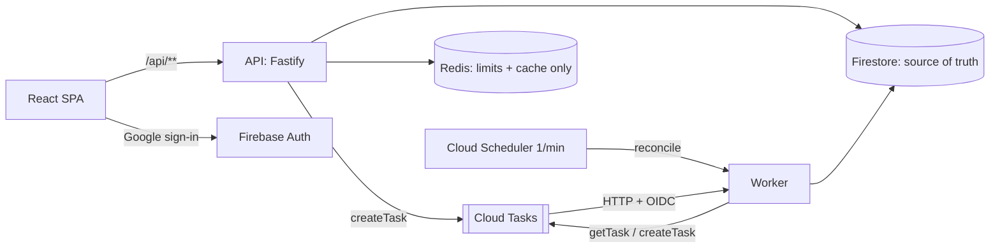

# QueuePilot

[Türkçe](README.tr.md) · [Architecture](docs/ARCHITECTURE.md) · [Decisions (ADRs)](docs/DECISIONS.md) · [Tasks](docs/TASKS.md) · [Project state](docs/PROJECT_STATE.md)

QueuePilot is an engineering showcase of **durable request ingestion with asynchronous processing**.
Clients submit requests in bursts; the API persists each one before answering `202 Accepted`, and an
independent worker processes it later, with retries, leases and a reconciler that recovers lost work.

**Status:** the local MVP (API, worker, reconciler, Redis limits, React dashboard) works end to end on
Firebase emulators and passes CI. **Nothing is deployed to Google Cloud**; the Google Cloud checks (C1-C9) are
NOT RUN. A first live deployment on free tiers (Render free, Firebase Spark, Upstash) was run once on 2026-10-22/23 and is
temporary; its cloud figures are one run each. See [Known limitations](#known-limitations) and [Cloud deployment status](#cloud-deployment-status).

## Why it exists

Bursty traffic is a classic reliability problem: accepting work faster than it can be processed, without
losing it, without processing it twice in a harmful way, and without letting one tenant starve the rest.
QueuePilot demonstrates one answer to that problem on a deliberately small domain
(*burst intake → durable acceptance → rate-limited async triage → status tracking*), and is explicit
about what it does **not** claim (see below).

## Technology

Node.js 24 · TypeScript (strict) · Fastify · Zod · Firestore (source of truth) · Firebase Authentication
(Google sign-in) · Google Cloud Tasks · Redis via ioredis (limits and cache only) · React + Vite + Tailwind ·
pnpm 10 workspaces · Vitest · GitHub Actions. Target platform (not yet deployed): Cloud Run, Cloud Scheduler,
Firebase Hosting, region `europe-west1`.



It is a modular monolith: `packages/contracts` (Zod schemas), `packages/domain` (pure state machine and
decision tables), `packages/core` (adapters), `apps/api`, `apps/worker`, `apps/web`. Dependency direction is
enforced by ESLint. Full design: [docs/ARCHITECTURE.md](docs/ARCHITECTURE.md).

## Request lifecycle

1. The API verifies the Firebase ID token, then tenant membership, then validates the body, then applies the
   burst rate limit and submission quota, then ingestion admission control.
2. One atomic Firestore write creates the idempotency record, the request (`ACCEPTED`) and its first event.
   **Once that commit succeeds the request is durably accepted** and the API answers `202`. A failed or timed-out
   commit answers `503` and the client retries with the same key.
3. The API then creates a Cloud Tasks task as a best-effort wake-up. If that fails, the reconciler recovers it.
4. The worker takes a lease in a Firestore transaction, runs the deterministic triage, and commits
   `COMPLETED` (or `FAILED`) fenced by the lease. States: `ACCEPTED → PROCESSING → COMPLETED | FAILED`.

## Delivery guarantees (what is and is not claimed)

QueuePilot uses **at-least-once delivery with application-level guards**. It does **not** claim exactly-once
delivery, exactly-once Cloud Tasks semantics, or any bound on queue wait time. Duplicate or extra deliveries are
possible and are made harmless by the guards below.

- **Idempotency.** `Idempotency-Key` is required on `POST`. Scope is tenant + user; the fingerprint is the hash of
  the canonical validated body. Same key and body within 24 h → `202` with the same `requestId` and
  `Idempotent-Replayed: true`. Same key, different body → `409 IDEMPOTENCY_KEY_REUSED`. Expiry is checked in code,
  not by Firestore TTL.
- **Retries.** Cloud Tasks retries are a safety net only. The attempt budget (`MAX_ATTEMPTS=5`) is counted in
  Firestore, never from queue headers. Transient errors return the request to `ACCEPTED`; exhausting the budget → `FAILED`.
- **ADR-017, dispatch is a wake-up, never a correctness signal.** A task only wakes a worker. Firestore alone decides
  whether to execute. Every dispatch order commits `seq++` before `createTask`, so each task name `r-{id}-{seq}` has
  exactly one creator and `ALREADY_EXISTS` counts as created. The reconciler redispatches lost work (prompt orders, then
  slower "attention" orders) and never fails a request because of dispatch trouble. Extra tasks cost 409/200 responses, not
  wrong state.
- **Worker lease and fencing.** A delivery acquires a 60 s lease (`leaseId`) in a transaction. Only the holder of the
  current `leaseId` can commit `COMPLETED`/`FAILED` (invariant I4); a stalled worker whose lease was taken over cannot
  overwrite the result. Terminal states are absorbing (I3).
- **Invariants I1–I7** are listed in [ARCHITECTURE §7](docs/ARCHITECTURE.md) and covered by table-driven domain tests,
  a race suite and fuzz tests.

## Firestore is authoritative

All business state (requests, events, idempotency keys, memberships, tenants) lives in Firestore. Redis never holds
business state: losing Redis cannot lose or duplicate a request.

## Redis quota policy

Redis is used for rate limits, submission quotas and a 5 s metrics cache only.

| Use | Redis healthy | Redis unavailable |
|---|---|---|
| Burst limit (per user per minute) | shared atomic counter (Lua) | per-instance memory limiter at `limit / maxInstances`, logged as degraded |
| Submission quota (per user/day, per tenant/day), tenants with `quotaMode=enforced` | atomic Lua reservation of user + tenant counters | **fail closed: `503 QUOTA_UNAVAILABLE` with `Retry-After`**. Replays of already accepted requests still succeed |
| Metrics cache | Redis | in-memory cache + Firestore `count()` |

Quota exhaustion answers `429 QUOTA_EXCEEDED` with `Retry-After` = seconds to the UTC day boundary. A reservation is
released only when the Firestore commit definitely failed; after an ambiguous outcome it is retained until the UTC day rollover
([ADR-018](docs/DECISIONS.md)). `QP_QUOTA_FAILURE_MODE=open` exists for non-production use only.

## Local setup

Prerequisites: Node 24, Java 21+ (Firebase emulators), and a Redis server on `localhost:6379` for the Redis integration
tests. pnpm is pinned in `package.json`; if it is not on `PATH`, prefix commands with `corepack` (for example
`corepack pnpm install`). No global installs are needed. On Windows put the JDK `bin` before Oracle's `javapath` on `PATH`.
Redis is not packaged for Windows: use WSL, Docker or Memurai, or rely on CI for the Redis suite.

```sh
pnpm install --frozen-lockfile
pnpm build
```

### Environment configuration

[.env.example](.env.example) documents local settings (demo project `demo-queuepilot`, emulator hosts, `REDIS_URL`,
`QP_REDIS_ENABLED`, `QP_MAX_INSTANCES`, `QP_QUOTA_FAILURE_MODE`). Scripts do **not** load `.env` automatically; export the
variables or pass them inline. Never put real credentials in the repository.

### Firebase emulators

```sh
pnpm emulators        # Auth (9099) and Firestore (8080), project demo-queuepilot, no login needed
```

### Start the API and the worker

After `pnpm build` and with the emulators running, start the API and the worker as two separate processes. The exact
commands and environment for a fully local pair (local queue pump, local worker auth, demo project only) are in
[docs/verification/README.md](docs/verification/README.md). `pnpm build` also produces the bundled deployable artifacts
`apps/api/dist/index.js` and `apps/worker/dist/index.js`, which CI syntax-checks. The web app runs with
`pnpm --filter @queuepilot/web dev`.

## Tests

| Command | What it runs | Needs |
|---|---|---|
| `pnpm lint` / `pnpm typecheck` / `pnpm build` | ESLint (incl. dependency boundaries), TypeScript, bundles | – |
| `pnpm test` | Node unit tests (Vitest), web jsdom tests, offline infrastructure and owner-script tests | – |
| `pnpm test:integration` | Starts Auth + Firestore emulators and runs API/worker integration, web→API smoke, worker startup smoke, **real-Redis suites** | Java 21, Redis on `REDIS_URL` |

Real-Redis tests are `tests/integration/redis.test.ts` (Lua scripts), `tests/integration/redis-adapters.test.ts`
(quota store, rate limiter and connection recovery) and `apps/api/test/integration/redis-quota.test.ts` (HTTP API with Firestore
emulator and real Redis). They have no skip path: they fail if Redis is missing. Other suites use emulators or test doubles, as
labelled in each file. The Cloud Tasks queue is always a double outside real cloud.

### Local smoke tests

`docs/verification/e2e-local.mjs` (25 checks against a real built API and worker, emulators, no Redis required) and the
smoke steps inside `pnpm test:integration`. Auth is the emulator's Google provider, **not real OAuth**. See
[docs/verification/README.md](docs/verification/README.md).

## Local load tests (B6)

```sh
pnpm build
node tests/load/run.mjs                 # baseline, spike, recovery, worker throughput; 3 repetitions each (~15 min)
node tests/load/run.mjs --quick --reps 1
```

Method and the full scenario table: [tests/load/README.md](tests/load/README.md). Raw data and report of the recorded run:
[tests/load/results/2026-10-20T10-19-00-417Z/](tests/load/results/2026-10-20T10-19-00-417Z/REPORT.md).

**Measured under local conditions (Windows laptop, i7-8750H, 12 logical CPUs, 16 GB, Firebase emulators, one API and one worker
process, 3 repetitions, medians):**

| Scenario | Observation |
|---|---|
| Baseline, 20 req/s × 15 s | 300/300 accepted and completed in every repetition; create-path HTTP p50 ≈ 43 ms, p95 ≈ 53 ms, p99 ≈ 57 ms |
| Spike, 100 req/s × 8 s | ≈ 353 of 800 accepted per run, all of them completed (0 failed, 0 lost); the rest rejected `503 OVERLOADED` by admission control |
| Recovery after the spike | backlog peak 222–235; back to ≤ 10 outstanding 21–24.5 s after the spike ended |
| Worker throughput (direct deliveries, no queue) | ≈ 1.7/s at concurrency 1, ≈ 14/s at 8, ≈ 51/s at 32 (handler + Firestore **emulator**) |

These numbers are **not production benchmarks**. The load generator shares the machine with the system under test; Firestore
is the emulator; end-to-end completion times are bounded by the in-process local queue, which is rate-limited to 20 dispatches/s;
the Redis-enabled variant against a real Redis was **not run** (only Redis off, and Redis enabled but unreachable); k6 was
not run; Upstash QStash and Redis were used in one live free-tier run (n=1), but there is no Redis load benchmark, and Cloud Run and Cloud Tasks were never measured. No throughput figure such as "10,000 RPS" is claimed or
demonstrated.

## Known limitations

- **Not production-ready.** No Google Cloud deployment; one temporary free-tier run exists (figures are one run each). No security certification or external audit.
- Cloud Tasks semantics assumed by the design (ADR-003/011/017) are **not verified** until the owner runs the cloud spike
  (checks C1–C9, **NOT RUN**). The design degrades to extra tasks, not to wrong state, if they are wrong.
- Redis Lua scripts and adapters run against real Redis in CI only; the maintainers' Windows machine has no Redis.
- Google sign-in has only been exercised through the Auth emulator, never against real Google OAuth.
- Load figures are local and emulator-based (see above). No cloud scalability is claimed.
- Admin retry of failed requests is deliberately not enabled. There is no license file yet; licensing is awaiting the owner's decision.

## Cloud deployment status

**Google Cloud path: not started.** No Google Cloud project, billing, Cloud Run service, queue or Scheduler job exists (C1-C9 NOT RUN).
A first live deployment on free tiers (Render free, Firebase Spark, Upstash) was run once on 2026-10-22/23 and is temporary; its figures are one run each (see [docs/TASKS.md](docs/TASKS.md), "B9-9 live results").
Infrastructure scripts, API and worker Dockerfiles, guarded deploy/shutdown wrappers, an admin-grant script and a demo seed script are written and
tested offline or on emulators only ([infra/README.md](infra/README.md), [infra/CLOUD_VERIFICATION.md](infra/CLOUD_VERIFICATION.md)); every state-changing
step needs explicit owner approval and is dry-run by default. Check readiness locally with `node scripts/preflight.mjs` (it never contacts Google Cloud unless the owner adds `--run`, which only reads).
The step-by-step owner runbook is in [docs/DEPLOYMENT_RUNBOOK.md](docs/DEPLOYMENT_RUNBOOK.md). The local emulator demo and a cloud deployment are different
things: the former is what this repository demonstrates today, the latter is unverified (C1-C9, real Google OAuth, Cloud Run/Tasks behaviour, real-Redis load and k6 are NOT RUN; Upstash QStash and Redis were used only in the single free-tier run).

## GitHub Actions verification

[`.github/workflows/ci.yml`](.github/workflows/ci.yml) runs on every push and pull request on Ubuntu with Node 24, Java 21 and a
`redis:7.4-alpine` service: frozen-lockfile install, lint, typecheck, unit tests (node, web, infrastructure), build, then the
integration suite (emulators, real Redis, smoke tests) and a Node ESM artifact check. A second job builds the API and worker images from the
repository root (`docker build -f apps/<app>/Dockerfile .`), smoke-runs them with demo-only settings and never pushes or logs in to a registry. Check the
Actions tab of the repository for the latest run; this README does not hard-code a result.
