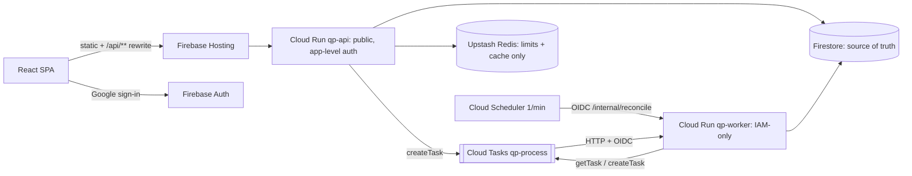

# QueuePilot Architecture (v0.2, frozen)

Single source of truth for design. Agents read only the sections they need (`grep -n "^## "`).
Decisions and their rationale are in `docs/DECISIONS.md`. Do not restate them elsewhere.

## 1. Scope

A request ingestion and asynchronous processing platform. The MVP demonstrates one generic workflow:
**burst intake → durable acceptance → rate-limited async triage → status tracking**.
Non-goals for the MVP: multi-region, exactly-once delivery, external side effects, and Kubernetes, Kafka or microservices.

## 2. System overview



Region: `europe-west1` for Firestore, Cloud Run and Cloud Tasks (irreversible for Firestore).

## 3. Repository layout and dependency rules

```
apps/web        React+Vite+Tailwind     -> contracts only
apps/api        Fastify composition root -> core, domain, contracts
apps/worker     Fastify composition root -> core, domain, contracts
packages/contracts  Zod schemas, DTOs, error codes, TaskPayload (deps: zod)
packages/domain     Pure logic: decision tables, triage rules, fingerprint, idempotency expiry (no IO)
packages/core       IO adapters: config, log, auth, membership, requests repo, idempotency,
                    queue (CloudTasks + LocalDispatchQueue), processing, reconciler,
                    admission, ratelimit/quota, cache, metrics
tests/integration   Firestore/Auth emulator + Redis + LocalDispatchQueue (fake Clock)
tests/load          k6 scripts, verify.ts, sampler, results/*.json
infra/              gcloud scripts, firestore.rules, firestore.indexes.json, queue config
```

- Imports flow only downward: `apps → core → domain → contracts`. Domain never imports IO.
- Interfaces exist only at IO seams: `QueuePort`, `RateLimiter`, `QuotaStore`, `Cache`, `RequestRepository`, `IdempotencyStore`, `MembershipStore`, `Clock`.
- Errors use RFC 9457 Problem Details with `code` and `correlationId`. Stack traces are never exposed.
- The API is versioned under `/api/v1`. Changes inside v1 are additive only.
- Firestore documents carry `schemaVersion`. Changes are additive only and are read through Zod at the repository boundary.

## 4. Request lifecycle

1. The API verifies the token, then membership (§11), then the kill switch, then Zod validation, then rate limit and quota (§12), then admission (§10).
2. One atomic batch `create()`: `idempotencyKeys/{h}` + `requests/{id}` (`ACCEPTED`, `seq=1`, `watchdogAt=now+60s`) + `events/ACCEPTED`.
   **Once this commit succeeds, the request is durably accepted.** Commit failure or timeout → `503`. The client retries with the same key.
3. `createTask r-{id}-1` with a 2 s timeout. A failure is logged only; the reconciler recovers it. No status write follows.
4. Respond `202 Accepted` with `requestId` and `Location`. Meaning: persisted, will be processed at least once, not yet processed.
5. Worker: lease txn → deterministic triage (≤20 s) → completion txn with `leaseId` fencing → `200`.

## 5. Data model (Firestore)

| Collection | Key | Main fields | Notes |
|---|---|---|---|
| `tenants/{tenantId}` | slug | `name, status(active/suspended), openSignup, limits{submitPerMin, submitPerDayUser, submitPerDayTenant}, quotaMode(enforced/none)` | `sandbox` (open), `loadtest` (operator-only, `quotaMode:none`) |
| `memberships/{uid}` | uid | `tenantId, role(member/admin), status(active/suspended), createdBy(bootstrap/operator), updatedAt` | No PII. Never client-writable |
| `requests/{uuid}` | UUIDv4 | `tenantId, createdBy, type, title, description, priority, attributes, status, statusReason?, processing{attempts, leaseId?, leaseExpiresAt?, lastError?, duplicateDeliveries}, dispatch{seq, deliveredSeq, checks, lastError?}, watchdogAt?, watchdogShard(0..3), rulesVersion, result?, timestamps, correlationId, source(ui/api/loadtest), expiresAt?(loadtest only), schemaVersion` | |
| `requests/{id}/events/{eventId}` | `{type}-a{attempt}` / `-s{seq}` | `type, at, actor, attempt, seq, details, correlationId, expiresAt?` | Deterministic IDs make writes idempotent |
| `idempotencyKeys/{sha256(tenant:uid:key)}` | hash | `requestId, payloadFingerprint, createdAt, expiresAt(=+24h)` | TTL policy on `expiresAt` |

Firestore security rules deny all client access. Only the backend reads and writes, through the Admin SDK.

## 6. State machine

Stored `status` values: `ACCEPTED | PROCESSING | COMPLETED | FAILED`.
UI-only derived views: `QUEUED` (ACCEPTED, attempts=0) and `RETRYING` (ACCEPTED, attempts>0).
Constants: `MAX_ATTEMPTS=5`, `MAX_DISPATCH=3`, `LEASE=60s`, `PROC_TIMEOUT=20s`.

| # | From | Trigger | Guard | To | Effects |
|---|---|---|---|---|---|
| S1 | ∅ | POST | key absent or logically expired | ACCEPTED | seq=1, deliveredSeq=0, attempts=0, watchdog=+60s |
| S2 | ACCEPTED | delivery(seq) | seq==dispatch.seq, attempts<MAX | PROCESSING | attempts++, new leaseId, leaseExp=+60s, deliveredSeq=seq, watchdog=leaseExp+30s |
| S3 | PROCESSING | delivery(seq) | lease expired, seq current, attempts<MAX | PROCESSING | same as S2 + `LEASE_TAKEOVER` event |
| S4 | PROCESSING | success | leaseId matches | COMPLETED | result, completedAt, delete watchdog |
| S5 | PROCESSING | transient error | leaseId matches, attempts<MAX | ACCEPTED | clear lease, lastError, watchdog=+5m. HTTP 503 |
| S6 | PROCESSING | transient error | leaseId matches, attempts≥MAX | FAILED | `ATTEMPTS_EXHAUSTED`. HTTP 200 |
| S7 | PROCESSING | permanent error | leaseId matches | FAILED | `PERMANENT_ERROR`. HTTP 200 |
| S8 | ACCEPTED/PROCESSING (lease expired) | delivery or reconciler | attempts≥MAX | FAILED | `ATTEMPTS_EXHAUSTED` |
| S9 | ACCEPTED/PROCESSING (lease expired) | reconciler: task absent | seq<MAX_DISPATCH | unchanged | seq++, then createTask |
| S10 | same | reconciler: task absent | seq≥MAX_DISPATCH | FAILED | `DISPATCH_EXHAUSTED` |
| S11 | COMPLETED/FAILED | any | – | unchanged | absorbing |
| S12 (P1) | FAILED | admin retry | role=admin (uncached check) | ACCEPTED | new retry budget, seq++ |

**Worker, `decideDelivery(doc, delivery, now)`** (first match wins):

| Condition | Decision | HTTP |
|---|---|---|
| no document | ORPHAN | 200 |
| terminal | DUPLICATE_SUPPRESSED (duplicateDeliveries++) | 200 |
| seq < dispatch.seq | STALE_DISPATCH | 200 |
| PROCESSING and lease valid | LEASE_HELD (no write) | **409** |
| attempts ≥ MAX | FAIL(ATTEMPTS_EXHAUSTED) | 200 |
| otherwise | ACQUIRE_LEASE, then process | 200 or 503 |

**Reconciler, `decideReconcile(doc, probe, now)`**. Query: `watchdogShard==s AND watchdogAt<=now`, limit 25 per shard, every 60 s.

| Step | Condition | Decision |
|---|---|---|
| 1 | terminal | clear watchdog |
| 2 | PROCESSING, lease valid | watchdog = leaseExp+30s |
| 3 | attempts ≥ MAX | FAIL(ATTEMPTS_EXHAUSTED) |
| 4 | getTask = EXISTS | wait: checks++, watchdog = now + min(2^checks min, 15 min) |
| 5 | getTask = NOT_FOUND and deliveredSeq < seq | createTask with the **same name**. OK → watchdog +5m. ALREADY_EXISTS → step 6. Other error → back off, seq unchanged |
| 6 | NOT_FOUND and (delivered or tombstone) | seq<MAX_DISPATCH: txn seq++ (guard: seq and status unchanged), then createTask. Otherwise FAIL(DISPATCH_EXHAUSTED) |
| – | getTask = **any other error** (incl. PERMISSION_DENIED) | `PROBE_UNKNOWN`: no state change, watchdog +1m, ERROR log. **Never treated as absence** (ADR-011) |

## 7. Invariants (must hold; changes require an ADR)

- **I1** A `202` response implies the request document is committed.
- **I2** At most one request per `(tenant, uid, key)` within the logical idempotency window.
- **I3** Terminal states are absorbing.
- **I4** Only the holder of the current `leaseId` can commit COMPLETED or FAILED from PROCESSING.
- **I5** Business logic starts at most `MAX_ATTEMPTS` times per request (counted in Firestore, not by queue headers).
- **I6** Triage output is a pure function of (request content, `rulesVersion`).
- **I7** `dispatch.seq` increments only after the task's absence is proven.

**Liveness.** Crashes and transient errors are recovered by Cloud Tasks retries plus lease takeover. Lost enqueues and exhausted tasks are recovered by the reconciler. If the reconciler is down, those requests stay non-terminal but durable, and `stuck = count(watchdogAt < now-15m)` exposes them.
**Non-claims:** exactly-once delivery, effectively-once external side effects, any bound on queue wait time.

## 8. Cloud Tasks

- Task name `r-{requestId}-{seq}`. Payload `{requestId, tenantId, seq, correlationId}`. OIDC uses `qp-tasks-invoker-sa`.
- Queue settings: `maxAttempts=10`, `maxRetryDuration=600s`, `minBackoff=2s`, `maxBackoff=60s`, `maxDoublings=4`, `maxDispatchesPerSecond=20`, `maxConcurrentDispatches=30`. Worker `dispatchDeadline=30s`.
- A task is deleted only when **both** maxAttempts **and** maxRetryDuration are exhausted. Queue retries are a safety net only; correctness relies on Firestore (I5).
- The `X-CloudTasks-TaskRetryCount` and `TaskExecutionCount` headers are per task and include infrastructure failures. They are logged only.
- A name stays deduplicated for about 1 h after deletion. `ALREADY_EXISTS` is information, never proof of delivery.
- Semantics are verified in the cloud spike (C1–C9, `docs/TASKS.md` B2). If the spike contradicts them, the fallback is a conservative time-based step 4 (ADR-003).

## 9. Idempotency

- The `Idempotency-Key` header is required on POST (8–128 chars). Scope is `tenant + uid`. The fingerprint is sha256 of the canonical validated body.
- **Logical expiry.** `expiresAt = createdAt + 24h` is checked in code. Firestore TTL deletes asynchronously, so physical presence is irrelevant.
  - Before expiry: same fingerprint → replay (`202`, same `requestId`, `Idempotent-Replayed: true`). Different fingerprint → `409 IDEMPOTENCY_KEY_REUSED`.
  - After expiry: a transaction re-reads the record and, if it is still expired, overwrites it and creates a new request. Of two concurrent takeovers, one wins and the other sees a replay.
- TTL does not delete subcollections. `events` has its own TTL policy.

## 10. Ingestion admission control (ADR-012)

Bounds Firestore writes independently of Redis. Checks run in this order before any write:

1. **Global ceiling by construction:** API `maxInstances=5` × per-instance limits below.
2. **Per-instance token bucket** on POST: `QP_INGEST_RPS_PER_INSTANCE=40`. The accepted-POST ceiling is therefore 200/s, or about 600 writes/s, a configured ceiling and not a measured capacity.
3. **Per-instance in-flight commit semaphore:** `QP_INGEST_MAX_INFLIGHT=32`, with a 100 ms wait. When saturated → `503 OVERLOADED` + `Retry-After`.
4. **Backlog guard:** if `count(status==ACCEPTED)` (shared 5 s metrics value) exceeds `QP_MAX_BACKLOG=20000` → `503 BACKLOG_FULL`. If the metric is unavailable, the guard is skipped, because steps 2–3 still bound writes.
5. Bootstrap writes pass through the same semaphore and a per-uid/IP limiter.

The worker side is bounded by queue `maxDispatchesPerSecond` and `maxConcurrentDispatches`.

## 11. Authentication and membership (ADR-008, ADR-010)

- Google is the only sign-in provider. `verifyIdToken` (no revocation check) must report `email_verified` and `sign_in_provider=google.com`.
- The source of truth for tenant and role is `memberships/{uid}`. Custom claims are not used.
- `POST /api/v1/session/bootstrap` (idempotent) creates `{tenant: sandbox, role: member}` only when `tenants/sandbox.openSignup==true`. The role is a constant, never an input.
- Admin is granted **only** by `scripts/grant-role.ts`, run by the owner with their own ADC credentials. No API path elevates a role.
- No membership → `403 ONBOARDING_REQUIRED` (except `GET /me` and the bootstrap endpoint).
- **Cache consistency guarantee:**
  - Positive membership and tenant entries are cached per instance for at most `QP_MEMBERSHIP_CACHE_TTL=30s`.
  - Suspension, role downgrade, deletion and tenant kill switch take effect on every instance within **≤30 s**.
  - Negative lookups are never cached, so bootstrap takes effect immediately.
  - Admin-only operations always re-read the membership uncached, so revoking admin is immediate for privileged actions.
  - On a membership read failure the request fails closed (`503`). An expired entry is never served.
  - Disabling a Firebase user does not revoke already-issued ID tokens (≤1 h). **Membership suspension is the revocation mechanism.**
- Visibility: members see only their own requests. Admins see the whole tenant.

## 12. Redis (ADR-006, ADR-009)

Redis is used for exactly two things: limits and metrics cache. Business state never depends on it.

| Use | Normal | Redis unavailable (100 ms timeout, circuit opens for 30 s after 5 failures) |
|---|---|---|
| Burst rate limit (per user per minute) | Redis atomic counter | Per-instance memory limiter at `limit / maxInstances`. Logged as `ratelimit.degraded` |
| **Submission quotas** (per-user/day, tenant/day) where `quotaMode=enforced` | Redis counters | **Fail closed:** `503 QUOTA_UNAVAILABLE` + `Retry-After`. Never bypassed. `QP_QUOTA_FAILURE_MODE=open` is allowed only when `QP_ENV!=production`, which is checked at startup |
| Metrics cache (5 s, single-flight) | Redis | In-memory 5 s cache plus Firestore `count()` |

With `QP_REDIS_ENABLED=false` (benchmark "off" arm), only tenants with `quotaMode=none` (operator-provisioned `loadtest`) can submit. Open-signup tenants are rejected with `QUOTA_UNAVAILABLE`.

## 13. Indexes and hotspots

- Doc IDs are random (UUIDv4 or hash). Time-ordered IDs are forbidden.
- Single-field exemptions: `createdAt, updatedAt, startedAt, completedAt, watchdogAt, title, description, attributes, result, processing.*, dispatch.*`.
- Composite indexes: `(tenantId, createdBy, createdAt desc)`, `(tenantId, createdAt desc)`, `(watchdogShard, watchdogAt)`.
- Status counts use `count()` with index merging on `tenantId` and `status`.
- Known limitation: `(tenantId, createdAt)` is sequential within one tenant. Spike results report hotspot or 500/50/5 effects.
- Normal-path writes per request: 7 (3 API, 2 lease, 2 completion).

## 14. IAM (least privilege, ADR-011)

| Principal | Grants |
|---|---|
| `qp-api-sa` | `datastore.user`. On queue `qp-process`: `cloudtasks.tasks.create`. `iam.serviceAccountUser` on `qp-tasks-invoker-sa`. Secret accessor on `redis-url` |
| `qp-worker-sa` | `datastore.user`. On queue: custom role `qpReconciler` = `cloudtasks.tasks.create` + **`cloudtasks.tasks.get`**. `serviceAccountUser` on `qp-tasks-invoker-sa`. Secret accessor on `redis-url` |
| `qp-tasks-invoker-sa` | `run.invoker` on `qp-worker` |
| `qp-scheduler-sa` | `run.invoker` on `qp-worker` |
| `allUsers` | `run.invoker` on `qp-api` only (required by the Hosting rewrite; auth happens in the app) |

## 15. Config defaults

| Key | Default | Key | Default |
|---|---|---|---|
| API instances / concurrency | 0–5 / 80 | Worker instances / concurrency | 0–3 / 10 |
| API timeout | 15 s | Worker timeout | 60 s |
| Submit limits | 10/min/user, 30/day/user, 2000/day sandbox | Reconciler shards / limit per shard | 4 / 25 |
| Idempotency window | 24 h | Membership/tenant cache TTL | 30 s |

## 16. Failure test catalogue

P0: T1–T13. P1: T14–T16. The full table lives in `docs/TASKS.md` under B4.
All tests run against LocalDispatchQueue, which models tombstones, getTask, delete-on-2xx, the dual-condition deletion rule, rate and concurrency limits, pause/purge and fault injection, using a fake Clock.

## 17. Demo processing

Versioned triage rule table keyed by `type`. Inputs: `priority`, `safetyRisk`, `locationType`, `preferredWindow`. Outputs: `lane`, `slaTargetMinutes`, `team`, `score`.
A simulated slow "team capacity lookup" takes 200–800 ms, seeded by `hash(requestId)`, so the result is deterministic (I6).
